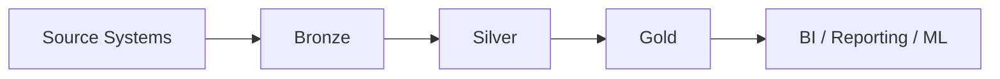

# 3-Tier Medallion Architecture

A well-structured data lake should follow a layered design so that raw data is preserved, cleaned progressively, and finally exposed as trusted business-ready datasets.

## Overview

The Medallion Architecture organizes data into three layers:

- Bronze: raw and immutable source data
- Silver: cleaned and standardized data
- Gold: curated, aggregated, and analytics-ready data

This pattern is commonly used in lakehouse and modern data engineering workflows.

---

## Recommended Folder Structure

```text
data-lake/
│
├── 🥉 bronze/
│   ├── crm/
│   │   ├── customers/
│   │   │   └── year=2026/
│   │   │       └── month=11/
│   │   │           └── day=10/
│   │   │               └── raw_customers_20261110.json
│   │   └── orders/
│   │       └── year=2026/
│   │           └── month=11/
│   │               └── day=10/
│   │                   └── raw_orders_20261110.parquet
│   │
│   └── erp/
│       └── transactions/
│           └── year=2026/
│               └── month=11/
│                   └── day=10/
│                       └── raw_transactions_20261110.csv
│
├── 🥈 silver/
│   ├── crm/
│   │   ├── dim_customers/
│   │   │   └── _delta_log/
│   │   └── fact_orders/
│   │
│   └── erp/
│       └── fact_transactions/
│
└── 🥇 gold/
    ├── finance/
    │   └── monthly_revenue/
    │       └── revenue_by_region.parquet
    │
    ├── sales/
    │   ├── customer_360/
    │   └── daily_sales_summary/
    │
    └── reporting/
        └── executive_dashboard/
```

---

## Layer Responsibilities

| Layer | Purpose | Typical Data State | Common Use |
| --- | --- | --- | --- |
| Bronze | Raw ingestion | Immutable, source-faithful | Audit, replay, reprocessing |
| Silver | Data quality and standardization | Clean, deduplicated, validated | Analytics prep, trusted datasets |
| Gold | Business-ready consumption | Aggregated and curated | Dashboards, BI, reporting |

### Bronze Layer

The Bronze layer stores raw data as it is received from upstream sources.

- Keep original files without modifying the source data
- Accept raw CSV, JSON, Parquet, logs, API responses, and database exports
- Preserve historical records for traceability and recovery
- Use append-only patterns and partitioning for easy ingestion management

### Silver Layer

The Silver layer improves data quality and prepares data for downstream analytics.

- Remove duplicates and invalid rows
- Standardize column names and data types
- Handle missing values and nulls
- Normalize dates, currencies, and codes
- Apply business validation rules

### Gold Layer

The Gold layer contains curated data optimized for business reporting and intelligence.

- Aggregate metrics for executive dashboards
- Build dimensional models and KPIs
- Provide data products for analysts and decision-makers
- Optimize for fast reporting and downstream ML use cases

---

## Typical Data Flow



---

## Why This Design Works

- Keeps raw data available for reprocessing and debugging
- Improves quality in stages instead of all at once
- Separates ingestion, transformation, and consumption responsibilities
- Makes pipelines more maintainable and scalable
- Supports both analytics and data science workloads

---

## Best Practices

- Use partitioning by date and business keys for large datasets
- Keep Bronze immutable to preserve traceability
- Store Silver in columnar formats like Parquet or Delta
- Design Gold tables for consumption, not for raw operational use
- Document schema changes and lineage across each layer

---

## Summary

The Medallion Architecture provides a clean progression from raw source data to trusted, analytics-ready business data. It helps organizations build scalable, governed, and maintainable data platforms.
